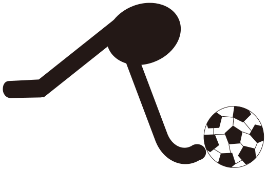

<p align="center">
  <picture>
    <source media="(prefers-color-scheme: dark)" srcset="ro-mark-white.svg">
    
  </picture>
</p>

# 浮力實驗室 Buoyancy Lab v0.3

接續原有 v0.2 的 Vite、React、React Three Fiber 與 Three.js 專案，提供木塊、鐵塊、不規則石頭、鐵碗的 3D 靜力平衡實驗。沿用深藍與暖金介面、單一物體選單，以及觀察／數值／計算三種資訊層級。

版本：0.3.0。供教師課堂展示及學生觀察浮沉、密度、排水量與受力關係。

## 線上操作

網站發布目標：[float.dg15.chatgpt.site](https://float.dg15.chatgpt.site/)。原始碼：[9royal/float](https://github.com/9royal/float)。

網站及 GitHub 存放庫沿用私人設定。請以獲准的帳號登入；這份原始碼不需要學生帳號、API 金鑰或雲端資料庫，實驗資料不會傳送至第三方分析服務。

## 開啟成品

Windows 可雙擊 `start-preview.cmd`。它會使用已安裝的 Node.js，或此電腦的 Codex 隨附 Node.js，啟動瀏覽器與本機預覽。關閉命令視窗或按 Ctrl+C 即停止服務。

也可在本資料夾執行：

```sh
node preview.mjs
```

開啟 <http://127.0.0.1:4178/>。此方式只需要 Node.js 與已建置的 `dist/`，不需要下載前端依賴。預覽服務僅綁定本機，僅提供 `dist/` 的內容。

## 接續開發

需要支援 WebGL 的現代瀏覽器。接續開發另需 Node.js 與 pnpm；本次以 Node.js 24.22.1、pnpm 11.25.0 驗證。依賴版本由 `pnpm-lock.yaml` 固定；專案僅允許 esbuild 執行依賴建置腳本。

```sh
pnpm install
pnpm test
pnpm run dev
```

開發服務也是 <http://127.0.0.1:4178/>，請先停止其他同埠預覽。

```sh
pnpm test:e2e
pnpm run build
node preview.mjs
```

瀏覽器測試優先使用已安裝的 Google Chrome，亦可設定 `CHROME_PATH`。若無可用瀏覽器，可執行 `pnpm exec playwright install chromium`。設定 `BASE_URL` 時會直接測試該網址，不另啟動開發服務。完整驗證紀錄見 [VALIDATION.md](VALIDATION.md)。

## 操作

1. 選擇物體並按「放入水中」。觀察模式不顯示實驗結果與公式。
2. 拖曳空白處旋轉視角，滾輪縮放；直接拖曳物體升降。放手後恢復由物體質量、液體密度與外力決定的平衡。
3. 水缸取得鍵盤焦點後，方向鍵可升降物體，放開按鍵即釋放。石頭可按 R，或 Shift 加拖曳，繞鉛直軸旋轉。
4. 外力向下為正，量程依物體調整；雙擊外力滑桿歸零。變更密度代表更換液體，會補滿水缸並重新收集。
5. 鐵碗可加入鋼製砝碼。碗緣入水或超過承載能力時觸發簡化進水情境；減重不會自動恢復空碗，請重設後再試。
6. 依序觀察量杯、等體積變形與疊合。實際收集量與當下排水量不一致時，會說明差異並返回操作。透明模型是幾何副本，實際液體保留在量杯。

計算模式顯示浮力、重力、外力與支持力箭頭、受力數值及公式代入。系統「減少動態效果」偏好會讓位置過渡及模型變形直接到達終點；平衡後場景停止持續重繪。

## 物理範圍

- 重力加速度取 9.8 m/s²。密度用 g/cm³，排水量用 cm³，外力用 N。
- 水缸水平面積為 600 cm²，溢流口高度 16 cm。水量始終滿足 `600 × 液面高度 − 當下排水體積 + 已收集量 = 9,600 cm³`。已流出液體不回流。
- 木塊為 600 g、1,000 cm³；鐵塊為 7,800 g、1,000 cm³；石頭為 2,600 g、1,000 cm³。石頭使用實際多邊形截面積分，並以相同幾何生成 3D 模型。
- 鐵碗使用約 100 cm³ 的鋼材，質量 780 g，外部排水容量約 1,231.5 cm³。載重是密度 7.8 g/cm³ 的鋼製砝碼；進水後僅鋼殼與砝碼排水。
- 手動升降同時求解液面與浸入體積，物體可以在完全浸沒時改變深度而不改變浮力。放在缸底時加入支持力。
- 等體積變形依實際顯示的封閉三角網格校正體積。測試涵蓋四種物體、六種部分浸入體積與各 21 個動畫時點，誤差低於 0.01 cm³。

這是靜力平衡教學模型。物體移動是平衡位置的視覺過渡，未求解加速度、黏滯流、水波、表面張力或真實進水速度。進水後的碗採可與水交換的鋼殼近似，未模擬提出水面時攜帶的水或排水過程。石頭僅繞鉛直軸轉動，未提供傾斜後的任意姿態積分。

物理依據：[OpenStax, University Physics Vol. 1, §14.4](https://openstax.org/books/university-physics-volume-1/pages/14-4-archimedes-principle-and-buoyancy)。

## 檔案與發布狀態

- `src/physics.js`：浮力、靜力平衡、溢流與手動高度的水量守恆。
- `src/experiment.js`：原子更新實驗狀態，保留溢水及進水歷史。
- `src/stone.js`：不規則幾何、截面積分與浸入深度反算。
- `src/morph.js`：實際三角網格的等體積變形。
- `src/Scene.jsx`：3D 器材、材質、觸控拖曳、受力箭頭與按需重繪。
- `src/main.jsx`、`src/style.css`：介面、模式、鍵盤與響應式版面。
- `tests/*.test.js`、`tests/e2e/`：物理、幾何及瀏覽器回歸測試。
- `preview.mjs`、`start-preview.cmd`：不需安裝套件的成品預覽。
- `ro-mark.svg`、`ro-mark-white.svg`：原始 Ro 品牌符號，依深淺主題使用。
- `.openai/hosting.example.json`：部署設定範本；部署到自己的 Sites 專案時填入該專案的身分，勿沿用別人的部署身分。

## 常見問題與更新

- **3D 顯示無法啟動**：檢查瀏覽器 WebGL 及硬體加速是否可用，再重新載入。
- **本機埠號被占用**：關閉前一個預覽視窗，或以 `PORT` 環境變數指定其他埠號。
- **GitHub 下載的原始碼沒有 `dist/`**：先執行 `pnpm install`、`pnpm run build`，再執行 `node preview.mjs`。
- **要更新版本**：更新原始碼後重新執行測試與建置；本機實驗狀態不會跨重新載入保留。線上版由網站擁有者重新部署。

授權條款尚未指定，本存放庫未附開源授權。版本紀錄見 [CHANGELOG.md](CHANGELOG.md)，驗收範圍見 [VALIDATION.md](VALIDATION.md)。
